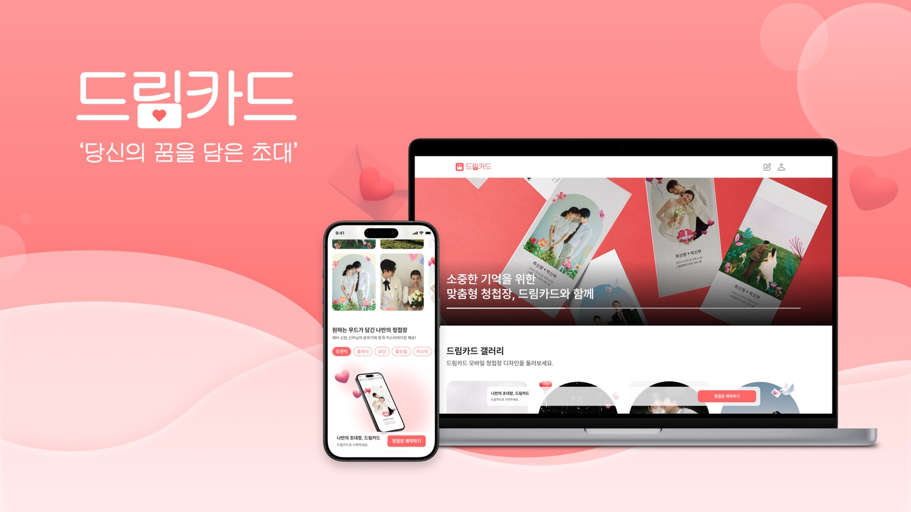

# Minyeong Kim

사용자의 흐름을 세심하게 살피고, 안정적인 제품으로 완성하는 프론트엔드 개발자입니다.

[**Portfolio**](https://minyeong-portfolio.vercel.app/) · [Blog](https://nninyeong.tistory.com/)

React, Next.js, TypeScript를 중심으로 웹 제품을 개발하고 있습니다.

제품이 어디서 어떻게 사용되는지 이해하고, 기기와 브라우저가 달라도 일관된 UX를 제공하도록 구현합니다. 사용자 환경의 제약에는 필요한 동작과 안전장치로 대응합니다.

반복되는 구현과 의사결정은 팀이 재사용할 수 있는 자산으로 만듭니다. 모노레포의 공용 UI와 패키지로 재사용성과 번들 효율을 높이고, AI 에이전트가 따를 개발 규칙을 지속적으로 정리해 팀의 개발 워크플로우를 개선해 왔습니다.

  
  
  

## Projects

### DreamCard

사용자가 직접 모바일 청첩장을 꾸미고 공유할 수 있는 서비스입니다.

팀 리드로서 프론트엔드 개발자 5명과 디자이너 1명의 작업 범위와 우선순위를 조율했습니다. 스티커의 위치·크기·회전을 편집하는 핵심 기능과 공유 페이지를 개발했고, 선택에 약 2초가 걸리던 스티커 에셋을 미리 불러오도록 개선해 바로 사용할 수 있게 했습니다.

내일배움캠프 React 트랙 최우수 프로젝트로 선정됐습니다.

[**포트폴리오에서 상세 보기**](https://minyeong-portfolio.vercel.app/#projects) · [GitHub](https://github.com/nninyeong/dream-card) · [Link](https://dream-card.co.kr/)

## Posts

실무에서 마주친 문제와 공부하며 이해한 내용을 기록합니다.

- [브라우저는 어떻게 화면을 그릴까? — 렌더링 파이프라인부터 Compositing Layer까지](https://nninyeong.tistory.com/180)  
  렌더링 버그의 원인을 따라가며 브라우저의 Parse부터 Composite까지 정리했습니다.
- [[Next.js / Tanstack Query] 내 prefetchQuery가 작동하지 않는 이유](https://nninyeong.tistory.com/151)  
  서버와 클라이언트의 실행 환경 차이를 추적해 스티커 에셋의 로딩 지연을 개선한 과정을 정리했습니다.

### Latest

<!-- BLOG-POST-LIST:START -->
- [새 창을 열면 브라우저에는 어떤 관계가 만들어질까?](https://nninyeong.tistory.com/185) — 2026.11.06
- [마이크로 프론트엔드 알아보기](https://nninyeong.tistory.com/184) — 2026.10.27
- [access token은 어떻게 만들어질까?](https://nninyeong.tistory.com/183) — 2026.10.21

<!-- BLOG-POST-LIST:END -->
